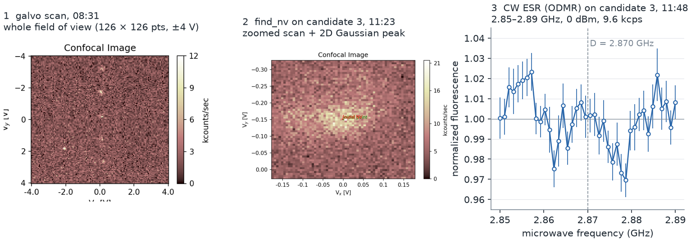
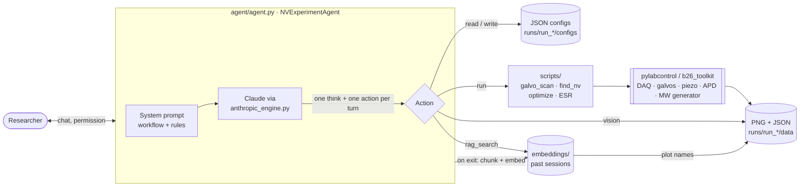

# Quantum Sensing Agent

**A Claude-based agent that ran a room-temperature scanning-confocal NV-center experiment in the lab, February–June 2025.**

📄 **Technical report:** [Quantum Sensing Agent: An LLM Agent that Operated a Scanning-Confocal NV-Center Experiment in Early 2025](docs/technical-report/qsa_technical_report.pdf) (Zhang, Xue, Fan, Yacoby). To our knowledge, this is among the earliest LLM agents to operate a quantum-sensing experiment: its first hardware session was on 18 February 2025.

The agent wrote measurement configs, launched the instrument scripts, read the resulting plots and proposed next steps, while a researcher at the setup directed it and added physical judgment. It can also search its own past sessions, including their plots, through retrieval over earlier conversations.



*14 May 2025, one session run by the agent ([`examples/2025-05-14-nv-odmr/`](examples/2025-05-14-nv-odmr/)).
(1) Galvo scan of the field of view. The researcher read six candidate spots off this image.
(2) `find_nv` zoomed scan on candidate 3. (3) CW ESR (optically detected magnetic resonance) on candidate 3,
re-plotted from the saved data: two dips at ≈2.863 and 2.878 GHz, on either side of the zero-field
splitting D = 2.87 GHz. The researcher logged "good we see ESR". Panels 1–2 are the lab toolkit's own renderings.
This figure shows the raw data; a two-Lorentzian fit is in the technical report.*

---

## What it does

- **Runs an NV measurement chain.** Four instrument scripts: `galvo_scan` (confocal raster),
  `find_nv` (zoomed scan + 2D Gaussian peak), `optimize` (focus sweep, usually z) and `ESR`
  (continuous-wave microwave frequency sweep with a Rohde & Schwarz generator). There are no pulsed sequences.
- **Configures by writing JSON.** It reads the default config for a script, changes parameter values
  (never keys), and saves a new config in the current run folder.
- **Reads its own plots.** After each measurement it can send the saved PNG and the recent conversation
  to Claude's vision input, and plan the next step from what it sees.
- **Can search past sessions.** Conversations are embedded at exit. The agent can search them (`rag_search`)
  and reopen the plots those sessions referred to. In the logged hardware sessions, retrieval did not measurably
  change the agent's behaviour.
- **Logs everything.** Each session gets `projects/NVExperiment/runs/run_<timestamp>/{configs,data,logs}`
  with a timestamped log of user messages, the agent's reasoning, actions, permissions and script output.

## Architecture



| Component | File | Role |
|---|---|---|
| Agent | [`agent/agent.py`](agent/agent.py) | Prompting, action parsing, permission gate, logging, CLI |
| LLM engine | [`agent/anthropic_engine.py`](agent/anthropic_engine.py) | Claude text and vision calls, prompt caching |
| Retrieval | [`agent/rag_engine.py`](agent/rag_engine.py) | all-MiniLM-L6-v2 embeddings, cosine search, plot-name extraction |
| Alternative engines | `agent/deepseek_engine.py`, `agent/togetherai_deepseek_engine.py` | Same interface, inactive by default |
| Instrument scripts | [`projects/NVExperiment/scripts/`](projects/NVExperiment/scripts/) | Thin wrappers: load JSON, run the toolkit script, save PNG + JSON |
| Default configs | [`projects/NVExperiment/configs/`](projects/NVExperiment/configs/) | Starting points the agent copies and edits |

## The measurement workflow

The system prompt encodes the usual path from a blank sample to a spectrum:

1. **`galvo_scan`.** Coarse confocal image of the field of view (default 126 × 126 points over ±4 V).
   Bright spots are NV candidates.
2. **`find_nv`.** Zoomed scan around one candidate. A 2D Gaussian fit marks the brightest point, and
   the beam is moved there.
3. **`optimize`.** 1D sweep (usually z) to maximize the fluorescence count rate.
4. **`ESR`.** CW microwave frequency sweep while counting photons. NV spin resonances appear as fluorescence
   dips around 2.87 GHz.

Each action is a JSON block: `message`, `read`, `write`, `run`, `vision` or `rag_search`. `run` accepts only
the four scripts above, in a fixed command format, and checks them against an allow-list. `read` and `write`
are restricted to the config and data folders.

## Safety model

Two modes are chosen at start-up:

| | **Assistant mode** (default) | **Auto mode** |
|---|---|---|
| `write`, `run`, `vision` | Each needs an explicit `yes` from the researcher. A refusal is logged and fed back to the agent | Granted automatically and logged as `AUTO MODE - PROCEEDING` |
| Loop | One action, then wait for the researcher | Continues until it sends a `message`, or stops after 10 steps |
| Intended use | Running real hardware with a person at the setup | Supervised runs once the workflow is trusted (see the 16 June 2025 test below) |

In both modes only the **first** action of a turn is executed. The script allow-list, the fixed command format,
and the folder restrictions apply in both modes.

> **History of the modes.** The Feb–Apr 2025 sessions asked permission per action, as assistant mode does now;
> the 14 May version did not log permission prompts. The two modes and the one-action-per-turn rule were added in
> June 2025, and the only hardware session with them (16 June 2025) ran in auto mode.

## Memory of past sessions

When a session ends (by `exit`, Ctrl-C or an error), the conversation is split into overlapping chunks
(10 turns per chunk, overlap 5). Each chunk is embedded with `all-MiniLM-L6-v2` and saved in
`projects/NVExperiment/embeddings/`, together with the names of the plots it mentions.

During a new session the agent can call `rag_search` when it is stuck or wants precedent. The query is built from
the recent conversation. The top matches are inserted in a clearly delimited *"relevant context from past
experiments"* block, and the agent can reopen the historical plots they reference with `vision`. In this way a
researcher's advice from an earlier session could shape decisions in a later one; in the logged hardware sessions
this did not happen measurably. The embeddings of the May 2025 sessions are included in the repository. (The
June 2025 code failed to save embeddings on exit because of an ordering bug, fixed in this release.)

## Deployment record

Counts follow the technical report: a measurement is **completed** only if the toolkit's "saved data" line appears
inside logged script output in [`projects/NVExperiment/runs/`](projects/NVExperiment/runs/). "Saved" lines that the
LLM wrote inside its own replies (invented tool output) are excluded; counting them would give 79 instead of 72 for Feb–May.

- **18 Feb – 16 Jun 2025: 73 completed measurements in 16 sessions on 10 days** on the Yacoby-lab NV confocal setup
  (20 galvo scans, 27 `find_nv`, 8 `optimize`, 18 ESR); 72 of them in Feb–May.

  | Date (2025) | 18 Feb | 19 Feb | 28 Feb | 1 Mar | 6 Mar | 11 Mar | 12 Mar | 19 Apr | 14 May | 16 Jun |
  |---|---|---|---|---|---|---|---|---|---|---|
  | Measurements | 2 | 9 | 7 | 8 | 1 | 4 | 7 | 10 | 24 | 1 |

- **19 Apr and 14 May 2025:** galvo → find_nv → optimize → ESR chains, with the researcher choosing candidates and
  frequency windows. On 14 May the agent worked through candidates 1–3 of six and reached candidate 4; ESR dips
  appeared on candidate 3 (figure above). Its data are in [`examples/2025-05-14-nv-odmr/`](examples/2025-05-14-nv-odmr/).
- **16 Jun 2025:** a short unsupervised auto-mode test. One galvo scan reached the instrument; the next run
  attempts (optimize, ESR) failed. The model also wrote invented script output into its own replies (fake
  find_nv, optimize and ESR results, including "ESR transitions found"), which the log makes visible, and then
  reasoned from those invented results.
- Most other spectra show no clear resonance, and none was fitted at the time.

The 18–19 Feb logs are `projects/NVExperiment/runs/agent_history*.log`. The `data/` output folders were not
committed, except for the 14 May data in `examples/`. The scripts that reproduce every count are in
[`analysis/`](analysis/).

## Quickstart

```bash
git clone https://github.com/zechenzhangAGI/quantum-sensing-agent.git
cd quantum-sensing-agent
python -m venv venv && source venv/bin/activate      # Windows: venv\Scripts\activate
pip install -r requirements.txt

cp env_template.txt .env      # then put your Anthropic API key in .env
python agent/agent.py         # run from the repository root; choose 1 (assistant) or 2 (auto)
```

- **Hardware control is not included.** The instrument scripts import the lab's own
  `pylabcontrol` / `b26_toolkit` stack, which is not part of this repository. Their `sys.path` lines point to the
  lab PC and must be adapted.
- The agent was deployed on Windows: its `run` action calls the Windows `py` launcher with `\` paths.
- **Without the hardware** you can still chat with the agent, have it read and write configs, search past
  sessions, and run vision on plots already in a run folder. `run` will fail.
- Offline test (no API key, no hardware): `pip install pytest`, then `python -m pytest tests/`. The other scripts in `tests/` need an
  API key and are run directly from the root (e.g. `python tests/test_rag.py`).
- On first use, `sentence-transformers` downloads the `all-MiniLM-L6-v2` model (about 90 MB) from Hugging Face.
- Models default to Claude 3.5 Sonnet (text) and Claude 3.7 Sonnet (vision). Override them with
  `DEFAULT_MODEL` / `SONNET_NEW` in `.env`.

## Repository layout

```
agent/                      agent, LLM engines, retrieval
projects/NVExperiment/
  scripts/                  galvo_scan.py, find_nv.py, optimize.py, ESR.py (wrap b26_toolkit)
  configs/                  default JSON configs
  runs/                     session archive: run_<timestamp>/{configs,logs}, Feb 2025 logs
  embeddings/               embedded past conversations (RAG memory)
examples/2025-05-14-nv-odmr/  measured data of the 14 May 2025 session + figure script
docs/technical-report/      technical report (PDF + LaTeX source)
docs/figures/               README figure
docs/dev-notes/             2025 development notes and task lists
analysis/                   scripts that reproduce the technical report's counts and figures
tests/                      test scripts
env_template.txt            template for .env (API keys)
```

## Citation

If you use this code or data, please cite the technical report (arXiv ID to be added):

```bibtex
@misc{zhang2026quantumsensingagent,
  title         = {Quantum Sensing Agent: An {LLM} Agent that Operated a Scanning-Confocal
                   {NV}-Center Experiment in Early 2025},
  author        = {Zhang, Zechen and Xue, Ruolan and Fan, Jack and Yacoby, Amir},
  year          = {2026},
  eprint        = {TBD},
  archivePrefix = {arXiv},
  howpublished  = {\url{https://github.com/zechenzhangAGI/quantum-sensing-agent}}
}
```

## Contributors

By git handle:

- **[@zechenzhangAGI](https://github.com/zechenzhangAGI)** (Zechen Zhang): project lead
- **[@itsjackfan](https://github.com/itsjackfan)** (Jack Fan)
- **[@rholanx](https://github.com/rholanx)**
- **[@SamC1249](https://github.com/SamC1249)**
- **google-labs-jules[bot]**

## Acknowledgments

This work was carried out in the **Yacoby Lab at Harvard University** (Prof. Amir Yacoby). The hardware
sessions were run at the setup by Zechen Zhang together with Ruolan Xue. The instrument layer is the lab's
`pylabcontrol` / `b26_toolkit` software.

## License

[MIT](LICENSE). Copyright (c) 2025-2026 Zechen Zhang and the Quantum Sensing Agent contributors.
